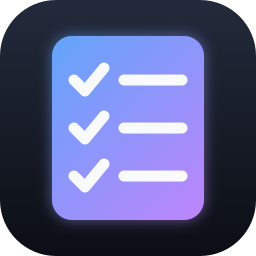
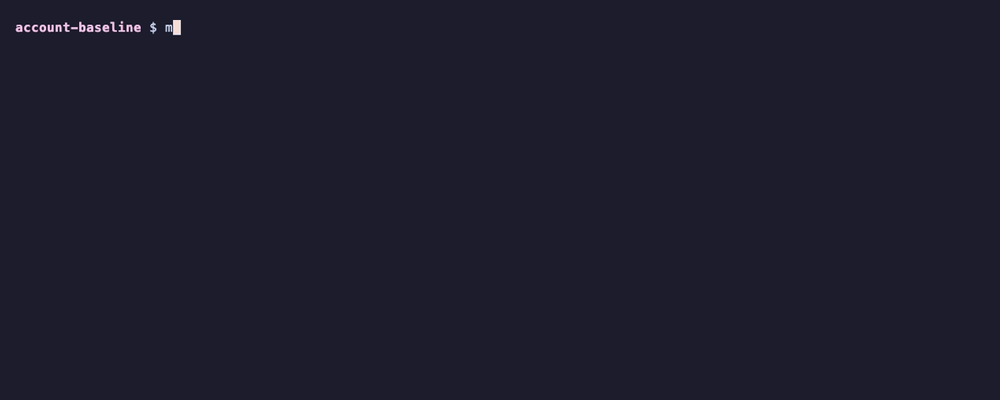

<div align="center">



# account-baseline

**Every new AWS account starts with settings that Security Hub marks as failed. One command fixes them.**

[](account-baseline.sh)
[](versions.tf)
[](cloudformation/account-baseline.yaml)
[](tests)
[](LICENSE)

<br>



<sub>Recorded against the fake AWS CLI from the tests. Try it with <code>make demo</code>, no AWS account needed.</sub>

</div>

## ✨ What it does

- **Blocks public access** to S3, EBS snapshots and SSM documents.
- **Encrypts new disks** by turning on EBS encryption by default.
- **Sets a password policy:** at least 14 characters, all character types, and none of your last 24 passwords.
- **Logs SSM Automation runs** to CloudWatch, and can set the account's alternate contacts.
- **Tells you what needs a person:** default VPCs and whether anything uses them, and regions with no private subnet.
- **Is safe to run again.**

Part of [aws-security-toolkit](https://github.com/simar-s2/aws-security-toolkit), and works on its own.

<a name="run-it"></a>
## ⚡️ Run it

With the AWS CLI v2 and credentials for the account:

```bash
git clone https://github.com/simar-s2/account-baseline && cd account-baseline
# Show what would change
./account-baseline.sh --profile my-account --regions us-east-1,us-west-2 --dry-run
# Make the changes
./account-baseline.sh --profile my-account --regions us-east-1,us-west-2
```

For every account in an organization, including accounts that join later, run this from the management account (`r-abcd` is your organization's root ID):

```bash
scripts/deploy.sh --profile management --regions us-east-1,us-west-2 --targets r-abcd
```

Terraform and every option: [docs/SETUP.md](docs/SETUP.md).

## 🔬 How it works

Some settings apply to the whole account and the rest are per region, so it covers each region you list. The script, Terraform and CloudFormation all apply the same settings, and the reports come from the script. Security Hub picks up the changes on its next check.

Every control it covers, and the choices I made: [docs/DESIGN.md](docs/DESIGN.md).

## 💰 Cost

Every setting is free. Encrypting disks with AWS's own key costs nothing extra; your own KMS key is about $1 a month plus requests. Security Hub, which does the checking, is [billed separately](https://github.com/simar-s2/org-security-baseline#cost).

## 💡 Things I learned

- **Don't assume a default VPC is unused.** A workload in a migrated account may really depend on one. The script counts its network interfaces, and only deletes it if there are none and you ask.
- **VPC Block Public Access blocks the good traffic too.** It stops internet gateway traffic for the whole region, including load balancers that are meant to be public, so it's off unless you turn it on.
- **Forced password expiry is out of date.** NIST SP 800-63B advises against it and the Security Hub control doesn't require it, so it's off by default.

## 🛠️ Development

```bash
make test    # pytest against the fake AWS CLI, terraform test with a mocked provider
make lint    # terraform fmt/validate, tflint, cfn-lint, checkov, shellcheck
make demo    # the run in the recording above
```

None of the tests call AWS. CI runs the same checks on every push.

## 📄 License

[MIT](LICENSE)
