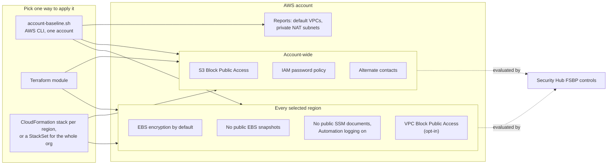

# account-baseline

**One idempotent command that fixes the account-level settings AWS Security Hub flags on every new AWS account, and reports the ones that need a human decision.**

Part of [aws-security-toolkit](https://github.com/simar-s2/aws-security-toolkit).


*`make demo` runs the script against the fake AWS CLI used by the tests, so it needs no AWS account.*

## What it does

A new AWS account starts with several settings that the Security Hub AWS Foundational Security Best Practices (FSBP) standard marks as failed: public EBS snapshot sharing is allowed, new volumes are unencrypted, there is no password policy, and so on. None of them are hard to fix, but they are easy to forget, and some are per region. This module applies them all in one step and is safe to re-run.

| Control | Setting | Scope | Script | Terraform | CloudFormation |
|---|---|---|:-:|:-:|:-:|
| S3.1 | Account-level S3 Block Public Access (all four settings) | account | yes | yes | yes |
| IAM.7 | Password policy: 14+ characters, all character classes, last 24 blocked | account | yes | yes | yes |
| Account.1 | Alternate BILLING, OPERATIONS and SECURITY contacts (optional) | account | yes | yes | yes |
| EC2.182 | Block public sharing of EBS snapshots | region | yes | yes | yes |
| SSM.7 | Block public sharing of SSM documents | region | yes | yes | yes |
| EC2.7 | EBS encryption by default for new volumes | region | yes | yes | yes |
| SSM.6 | SSM Automation logs go to CloudWatch | region | yes | yes | yes |
| EC2.172 | VPC Block Public Access (optional) | region | yes | yes | yes |
| EC2.9 | Report whether a private, NAT-routed subnet exists | region | report | | |
| EC2.2 | Report default VPCs and whether anything uses them; optionally delete unused ones | region | report + delete | output | |

**Tech:** Bash and the AWS CLI, Terraform (AWS provider 6), CloudFormation with a Python custom resource, pytest, GitHub Actions.

## Architecture



## Quick start

### Script

Needs the AWS CLI v2 and credentials for the target account.

```bash
git clone https://github.com/simar-s2/account-baseline && cd account-baseline
./account-baseline.sh --profile my-account --regions us-east-1,us-west-2 --dry-run   # show what would change
./account-baseline.sh --profile my-account --regions us-east-1,us-west-2
```

Add `--contact-email security@example.com --contact-phone +1-555-0100` to set the alternate contacts, and `--delete-default-vpcs` to remove default VPCs that have no network interfaces. `--regions all` covers every enabled region.

### Terraform

```hcl
module "account_baseline" {
  source = "git::https://github.com/simar-s2/account-baseline.git?ref=v0.1.0"

  regions = ["us-east-1", "us-west-2"]

  alternate_contact = {
    name  = "Cloud security team"
    email = "aws-security@example.com"
    phone = "+1-555-0100"
  }
}
```

See [examples/basic](examples/basic) and [examples/complete](examples/complete).

### CloudFormation

```bash
# One account: a stack per region (the first region also applies the account-wide settings)
scripts/deploy.sh --profile my-account --regions us-east-1,us-west-2

# Every account in the organization, including accounts that join later (run from the management account)
scripts/deploy.sh --profile management --regions us-east-1,us-west-2 --targets r-abcd
```

## Configuration

### Script options

| Option | Default | Description |
|---|---|---|
| `-p, --profile` | current credentials | AWS CLI profile |
| `-r, --regions` | the profile's region | Comma-separated regions, or `all` |
| `--contact-email`, `--contact-phone`, `--contact-name` | not set | Alternate contacts (email and phone are both required by the API) |
| `--block-igw` | off | VPC Block Public Access in `block-bidirectional` mode |
| `--delete-default-vpcs` | off | Delete default VPCs with no network interfaces |
| `--dry-run` | off | Print the changes instead of making them; the reports still run |

### Terraform inputs

| Name | Type | Default | Description |
|---|---|---|---|
| `regions` | `list(string)` | `[]` | Regions for the regional settings. Empty means the provider's region |
| `s3_block_public_access` | `bool` | `true` | Account-level S3 Block Public Access |
| `password_policy` | `object` | `{}` (14 chars, reuse 24, no expiry) | `minimum_length`, `reuse_prevention`, `max_age_days`. `null` leaves the policy unmanaged |
| `alternate_contact` | `object` | `null` | `name`, `title`, `email`, `phone` for the three contact types |
| `snapshot_block_public_access` | `string` | `block-all-sharing` | Or `block-new-sharing` |
| `ebs_default_kms_key_arns` | `map(string)` | `{}` | Customer managed KMS key per region for EBS default encryption |
| `vpc_block_public_access` | `string` | `off` | `off`, `block-ingress` or `block-bidirectional` |

### Terraform outputs

| Name | Description |
|---|---|
| `regions` | Regions the regional settings were applied in |
| `default_vpc_ids` | Default VPC ID per region, or `null` where there is none |

### CloudFormation parameters

`HomeRegion`, `MinimumPasswordLength` (14), `PasswordReusePrevention` (24), `SnapshotBlockPublicAccess` (`block-all-sharing`), `VpcBlockPublicAccess` (`off`), `ContactEmail`, `ContactName`, `ContactPhone`. Pass them to the deploy script with `--param Key=Value`.

## Cost

Every setting here is free. EBS default encryption with the AWS managed `aws/ebs` key costs nothing extra; a customer managed key is about $1 per month plus requests. The CloudFormation version runs a small Lambda function only when the stack is created or updated, which stays inside the free tier. Security Hub, which evaluates these controls, is billed separately (see [org-security-baseline](https://github.com/simar-s2/org-security-baseline#cost)).

## Design notes

- **Default VPCs are reported, not deleted.** A workload in a migrated account may really be using its default VPC. The script counts the network interfaces in it, and `--delete-default-vpcs` only removes VPCs with none.
- **VPC Block Public Access is opt-in.** It blocks internet gateway traffic for the whole region, including load balancers that are meant to be public, so it only suits accounts with no public-facing workloads.
- **The private subnet report exists for EC2.9.** Instances without a public IP need a subnet that routes `0.0.0.0/0` through a NAT gateway (or VPC endpoints for every service they call). Finding the gap during baselining is cheaper than finding it when a deployment fails.
- **No forced password expiry by default.** NIST SP 800-63B advises against periodic rotation, and IAM.7 doesn't require it. Set `max_age_days` if your policy does.
- **Deleting the CloudFormation stack leaves the custom resource's settings on** (EBS encryption, S3 Block Public Access, password policy, contacts), because removing a stack shouldn't quietly weaken an account. The native resources (snapshot and VPC block public access, SSM service settings) revert to the AWS defaults, as CloudFormation resources do.
- **Patch Manager tags live elsewhere.** Defaulting the `patch-reboot` tag on existing instances belongs to [org-patch-manager](https://github.com/simar-s2/org-patch-manager), which owns that tag's meaning.

## Project layout

```
account-baseline.sh          the script
main.tf, variables.tf, ...   Terraform module
cloudformation/              CloudFormation template (native resources + a custom resource)
scripts/deploy.sh            one-command CloudFormation deploy: stacks or an org-wide StackSet
examples/                    Terraform examples
tests/                       pytest suites (fake AWS CLI) and terraform test (mocked provider)
docs/                        the demo recording and its vhs tape
```

## Development

```bash
make test    # pytest against the fake AWS CLI, terraform test with a mocked provider
make lint    # terraform fmt/validate, tflint, cfn-lint, checkov, shellcheck
make demo    # the run in the recording above
```

None of the tests call AWS. CI runs the same checks on every push.

## License

[MIT](LICENSE)
